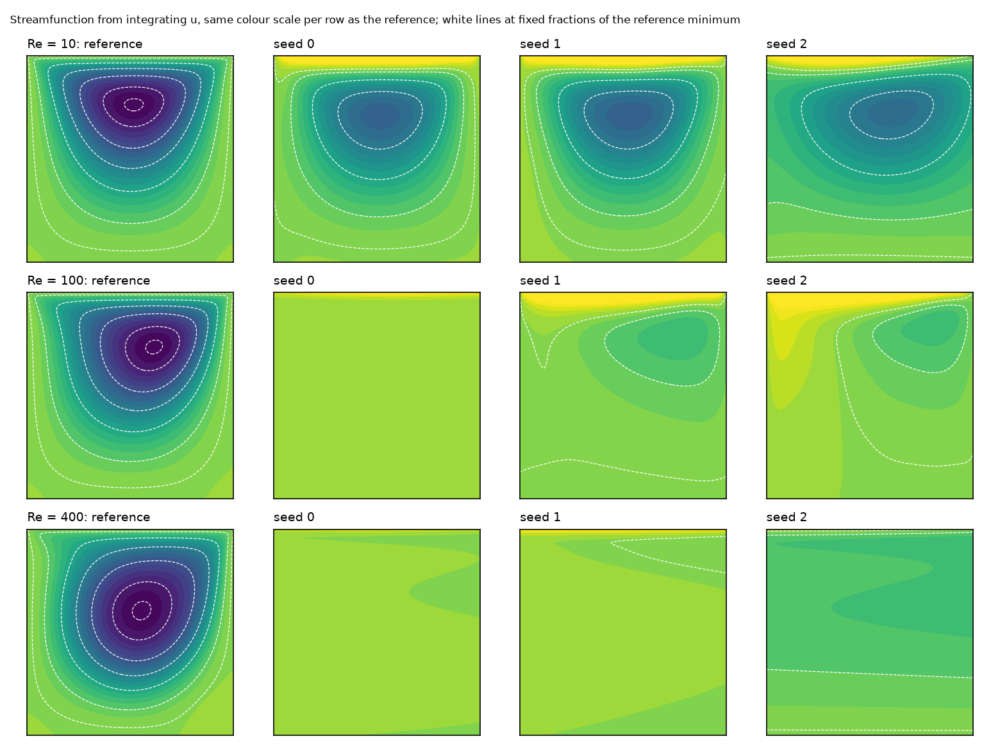

# The Reynolds-number study at the upstream training budget

This document reports the study of [`configs/full.yaml`](../configs/full.yaml), gap G1 of [EXPERIMENT_GAPS.md](EXPERIMENT_GAPS.md) and finding F15 of [SCIENTIFIC_AUDIT.md](SCIENTIFIC_AUDIT.md). Status labels follow [the audit's classification](SCIENTIFIC_AUDIT.md#classification).

**Question.** Do the failures at Re = 100 and 400 and the weaknesses of the loss, found at the reduced budget, persist at the training budget of the NVIDIA example?

**Short answer.** Yes:

- At Re = 100 and 400 no run recovers the cavity flow at the upstream budget. The velocity errors are 66% to 90%, and the primary vortex is absent or reduced to at most 19% of its strength.
- The analytic lid-layer field, which has no recirculation, still scores a loss at or below every trained network at Re = 100 and 400.
- The collapse to a constant field seen once in the reduced study did not recur in these nine runs.
- At Re = 10 the larger budget lowers the error in two of three seeds.

## 1. What was run

| Item | Value |
|---|---|
| Configuration | `configs/full.yaml`: the upstream network (6 × 512, SiLU), loss, sampling, Adam at $10^{-3}$ with the upstream per-step decay, 10 000 steps, 4000 interior and 2000 boundary points per step. Only the viscosity ($\nu = UL/\mathrm{Re}$) and the seed change between runs. |
| Matrix | Re ∈ {10, 100, 400} × seeds {0, 1, 2}: nine runs, the seed allocation of the audit |
| Configuration hash | SHA-256 of the resolved training recipe (everything except names, paths, device and the list of runs), `c9877ce004e7…`. It is identical for the three sessions and for `configs/full.yaml` at the reporting commit (`analysis.json`, `sessions.*.config_sha256`). |
| Hardware | Kaggle, Tesla T4 (15 GB), driver 580.178.04. Each session was allocated two T4s and used one. |
| Environment | `uv sync --frozen` from `uv.lock`: Python 3.13.15, PyTorch 2.14.1+cu130 (CUDA 13.0), NumPy 2.5.3, SciPy 1.18.1, SymPy 1.14.0, PhysicsNeMo 2.3.0a0 at commit `b45a5c8`. Full lists in `results/full/sessions/*/pip-freeze.txt`. |
| Code | Re = 100 and 400: commit `3ab0cca`. Re = 10: commit `36c76aa`. The two differ only in `evaluate_run`, which frees the residual graphs before timing inference (four added lines). The training code is identical. Both clones were clean (`git_dirty: false`). |
| Reference | The 513-node finite-difference solutions of [REFERENCE_SOLVER_VALIDATION.md](REFERENCE_SOLVER_VALIDATION.md), recomputed in each session and cached locally. |
| Evaluation | On CPU, locally, from the downloaded checkpoints, for all nine runs (`scripts/evaluate.py --config full device=cpu`). For the three Re = 10 runs the GPU also evaluated them, and the CPU recomputation agrees to $5.5 \times 10^{-8}$ relative (`--verify`; GPU records kept as `eval_metrics_cuda.json`). |
| Diagnostics | `scripts/analyse_full.py`, on CPU: `results/full/analysis.json`, `figures/full_streamfunction.png` |

### Sessions, including the interrupted ones

| Session | Commit | Outcome | Duration | Cause and action |
|---|---|---|---|---|
| Re 400, Re 100 | `eb07e62` | failed in the test step, no training | 0.06 h each | `pip install` into the Kaggle image mixed versions, and the image's RAPIDS `cuml`, which PhysicsNeMo imports when present, rejects NumPy 2.5. The launcher now installs `uv.lock` into its own environment. |
| Re 400, Re 100 | `69ddd82` | failed in the test step, no training | 0.03 h each | the image sets `MPLBACKEND` to the Jupyter inline backend, absent from the locked environment. Now set to `Agg`. |
| Re 400 | `3ab0cca` | all three runs trained to step 10 000. The GPU evaluation then ran out of memory. | 2.79 h | The residual graphs were still held during the inference timing. Fixed in `36c76aa`, no metric changes. Checkpoints and histories were saved and evaluated on CPU. |
| Re 100 | `3ab0cca` | as above | 2.63 h | as above |
| Re 10 | `36c76aa` | complete: training, GPU evaluation, figures, archives | 2.72 h | none |

No run was interrupted during training and none was repeated. Each Kaggle session's notebook was generated by `kaggle/prepare_kernel.py` from `kaggle/run_cuda.ipynb`, with `REYNOLDS` set to one value.

**Compute.**

- Training: 7.80 GPU-hours for the nine runs, 0.305 to 0.316 s per step, 3050 to 3158 s per run.
- Peak training memory: 3.46 GB.
- Kaggle session time including setup, tests, the 200-step probes and the failed sessions: about 8.3 GPU-hours.

## 2. Per-run results

Errors are relative $L^2$ errors on the 513 × 513 reference nodes. "Core" is at least $0.1L$ from every wall. Boundary errors leave out the two lid-corner nodes (audit F10). Residuals are RMS values without the distance weight, in units of $U/L$ and $U^2/L$. The validation loss is the loss of the example averaged over 25 independent draws of 4000 interior and 2000 boundary points, not seen in training, with its standard error. The final loss is the single minibatch recorded at step 10 000.

| Run | Velocity error | Core | Error of $v$ | Final loss (1 batch) | Validation loss | Walls, RMS | Lid, RMS | Continuity residual | $x$ momentum residual |
|---|---|---|---|---|---|---|---|---|---|
| Re 10, seed 0 | 0.350 | 0.439 | 0.442 | $1.32 \times 10^{-3}$ | $(1.16 \pm 0.02) \times 10^{-3}$ | 0.009 | 0.142 | 0.83 | 0.74 |
| Re 10, seed 1 | 0.349 | 0.407 | 0.426 | $6.41 \times 10^{-4}$ | $(7.57 \pm 0.10) \times 10^{-4}$ | 0.010 | 0.126 | 1.12 | 0.82 |
| Re 10, seed 2 | 0.505 | 0.676 | 0.752 | $2.46 \times 10^{-2}$ | $(2.86 \pm 0.02) \times 10^{-2}$ | 0.101 | 0.234 | 0.25 | 0.39 |
| Re 100, seed 0 | 0.837 | 0.995 | 1.001 | $1.02 \times 10^{-2}$ | $(1.03 \pm 0.02) \times 10^{-2}$ | 0.058 | 0.149 | 0.19 | 1.20 |
| Re 100, seed 1 | 0.669 | 0.892 | 0.966 | $6.81 \times 10^{-4}$ | $(7.37 \pm 0.10) \times 10^{-4}$ | 0.010 | 0.121 | 1.09 | 0.39 |
| Re 100, seed 2 | 0.655 | 0.882 | 0.915 | $8.97 \times 10^{-4}$ | $(9.24 \pm 0.23) \times 10^{-4}$ | 0.017 | 0.101 | 0.88 | 0.50 |
| Re 400, seed 0 | 0.904 | 1.000 | 1.000 | $7.52 \times 10^{-3}$ | $(5.61 \pm 0.21) \times 10^{-3}$ | 0.061 | 0.086 | 0.10 | 0.46 |
| Re 400, seed 1 | 0.881 | 1.012 | 0.999 | $8.29 \times 10^{-3}$ | $(1.43 \pm 0.04) \times 10^{-2}$ | 0.104 | 0.065 | 0.08 | 0.27 |
| Re 400, seed 2 | 0.860 | 0.970 | 1.002 | $1.44 \times 10^{-2}$ | $(1.71 \pm 0.03) \times 10^{-2}$ | 0.089 | 0.141 | 0.04 | 0.15 |

Source: [`results/full/summary.csv`](../results/full/summary.csv), [`results/full/analysis.json`](../results/full/analysis.json).

- Removing every node within $0.05L$ of a lid corner changes no velocity error by more than 0.011, so the errors are not a corner artefact.
- RMS differences to the tabulated centreline $u$ of Ghia et al. are 0.09 to 0.29 at Re = 100 and 0.22 to 0.31 at Re = 400.

**Checkpoints.** SHA-256 of the final checkpoints (first 12 hex digits of `FullyConnected.0.10000.mdlus`), full values in `analysis.json`:

| Run | Re 10 | Re 100 | Re 400 |
|---|---|---|---|
| seed 0 | `3bd428afb7c4` | `b4f021fdd317` | `810f2747f4de` |
| seed 1 | `6a2cf5a89b6c` | `77f753ff8801` | `8887a9e8c9ec` |
| seed 2 | `47eb7741433e` | `65c624c76314` | `8794634d36ac` |

The checkpoints are not tracked. They are kept locally under `runs/full/`.

### Per Reynolds number

Three seeds per Reynolds number. The 95% interval is the Student $t$ interval of the mean, $\bar{x} \pm 4.303\, s/\sqrt{3}$. With three values it is wide and describes these runs, not a population. The medians and ranges are the more robust summary.

| Re | Velocity error: values | Mean, 95% t interval | Median | Core error: mean | $\psi_{\min}$ / reference: values |
|---|---|---|---|---|---|
| 10 | 0.350, 0.349, 0.505 | 0.402 [0.179, 0.625] | 0.350 | 0.507 | 0.633, 0.641, 0.582 |
| 100 | 0.837, 0.669, 0.655 | 0.720 [0.468, 0.972] | 0.669 | 0.923 | 0.000, 0.190, 0.189 |
| 400 | 0.904, 0.881, 0.860 | 0.882 [0.827, 0.936] | 0.881 | 0.994 | 0.009, 0.031, 0.192 |

The validation losses span one to two orders of magnitude within a Reynolds number, so a $t$ interval on their mean is not meaningful. It crosses zero, and it is not reported. The values are in the table above.

## 3. Comparison with the reduced budget, seed by seed

The reduced study (`results/local`, Apple MPS) used half the steps and a quarter of the points. Pairs share Reynolds number and seed. The device differs, so a pair is not a controlled comparison of budget alone (see the device note below).

| Re | Seed | Reduced | Upstream budget | Difference | Return flow on the vertical centreline, $\min u / U$: reduced, upstream, reference |
|---|---|---|---|---|---|
| 10 | 0 | 0.473 | 0.350 | −0.123 | −0.130, −0.138, −0.208 |
| 10 | 1 | 0.456 | 0.349 | −0.107 | −0.139, −0.142, −0.208 |
| 10 | 2 | 0.456 | 0.505 | +0.049 | −0.161, −0.113, −0.208 |
| 100 | 0 | 0.802 | 0.837 | +0.035 | −0.018, +0.000, −0.214 |
| 100 | 1 | 0.805 | 0.669 | −0.137 | −0.012, −0.036, −0.214 |
| 100 | 2 | 1.607 (collapsed) | 0.655 | −0.952 | +0.333, −0.027, −0.214 |
| 400 | 0 | 1.078 | 0.904 | −0.174 | −0.026, −0.020, −0.329 |
| 400 | 1 | 0.871 | 0.881 | +0.010 | −0.008, −0.015, −0.329 |
| 400 | 2 | 0.889 | 0.860 | −0.029 | −0.037, −0.053, −0.329 |

Medians, reduced against upstream budget: 0.456 → 0.350 (Re 10), 0.805 → 0.669 (Re 100), 0.889 → 0.881 (Re 400).

**Device.** `full/re0010_seed0` (CUDA) has the configuration and seed of `official/re0010_seed0` (Apple MPS). They end at 0.350 and 0.383. The training trajectory is not reproducible across devices, and a difference of this size can come from the device alone. Differences of 0.03 or less in the table above should therefore not be read as effects of the budget.

**Seed 2 at Re = 10.** Its tracked error was 0.30 at step 9000. Its last optimiser step lands on a loss spike: the recorded loss rises from $6.4 \times 10^{-4}$ at step 9900 to $2.5 \times 10^{-2}$ at step 10 000, the largest jump of that run (38×). The validation loss of the final network, $2.9 \times 10^{-2}$, confirms that the final state is the spike, not a noisy record. The recipe keeps the last iterate, so this seed's final error depends on where a spike falls. The run is reported as it ended.

## 4. Recirculation

The streamfunction of each network is $\psi(x, y) = \int_{-L/2}^{y} u\, dy'$ on the reference grid, from `diagnostics.streamfunction`. The primary vortex is its minimum away from the walls (`diagnostics.primary_vortex`). Applied to the reference velocity, this recovers the solver's $\psi_{\min}$ to 0.5% and its vortex centre to the node (`tests/test_audit.py`).



| Re | Reference vortex centre $(x/L, y/L)$ | Network vortex centres | Distance to the reference centre, in $L$ |
|---|---|---|---|
| 10 | (0.518, 0.766) | (0.518, 0.713), (0.531, 0.713), (0.617, 0.730) | 0.053, 0.054, 0.106 |
| 100 | (0.615, 0.736) | seed 0: no vortex (minimum at the wall); (0.781, 0.803), (0.830, 0.852) | 0.95, 0.18, 0.24 |
| 400 | (0.555, 0.605) | (0.996, 0.963), (0.996, 0.939), (0.996, 0.932): at the downstream lid corner | 0.57, 0.55, 0.55 |

Coordinates in the unit square, $x^\ast = x/L + 1/2$.

- **Re = 10.** All three networks have one primary vortex below the lid, with 58% to 64% of the reference strength $|\psi_{\min}|$. Seeds 0 and 1 are displaced downwards by $0.05L$. Seed 2, which ends on a loss spike, is displaced by $0.11L$, mostly downstream.
- **Re = 100.** Seed 0 has no primary vortex: $\psi$ has no interior minimum. Seeds 1 and 2 have a vortex with 19% of the reference strength, displaced by $0.18L$ and $0.24L$ towards the downstream lid corner. It is confined to the upper part of the cavity, with fluid nearly at rest below. The vertical velocity error is 0.92 to 1.00.
- **Re = 400.** No network has a primary vortex in the cavity. The minimum of $\psi$ lies at the downstream lid corner, the vertical velocity is zero to within 0.2% of the reference norm (error 0.999 to 1.002), and the return flow on the centreline is 4% to 16% of the reference.

The integrated $\psi$ on the lid, zero for a divergence-free field with no wall flux, reaches 5% to 60% of $|\psi_{\min}|$ of the reference. The networks do not conserve mass across the cavity.

## 5. Hidden-layer collapse

For every final network, `network_state` records, per hidden layer and over every fourth reference node, how many of the 512 neurons are constant and how many are identically zero. `history.csv` was scanned for records at which all three residual terms fall below $10^{-20}$, the signature of the collapsed reduced run (audit F2).

- No neuron in any hidden layer of any of the nine networks is constant or identically zero over the cavity.
- No record of any run has vanishing residual terms.
- `re0100_seed1` had a tracked error of 1.50 at step 1000. The loss terms show a loss spike there (0.14, with non-zero residuals), not a collapse. The run recovered to 0.79 by step 2000.

**Status.** The collapse was observed in 1 of 9 runs of the reduced study (MPS) and in 0 of 9 runs at the upstream budget (CUDA), and in 0 of 3 at Re = 100. For a per-run probability $p$, zero events in nine runs gives a one-sided 95% upper bound of $p \le 0.28$. The phenomenon is **not reproduced** here. That neither establishes that it cannot occur at this budget nor attributes it to the budget, the device or any other factor. Its cause remains UNVERIFIED (audit F2).

## 6. The analytic counterexample under the same objective

`scripts/analyse_full.py` scores again the zero field, the best constant field and the $6 \times 5$ grid of lid-layer fields of audit F1. It uses the loss of this study (identical to the upstream loss), at 400 000 interior and 200 000 boundary points. These are analytic fields, not trained models. The values reproduce `results/audit/audit.json` exactly.

| Re | Best lid-layer field: loss | Its velocity error | Trained networks: validation loss | Ratio, trained / lid layer | Trained networks: velocity error |
|---|---|---|---|---|---|
| 10 | $2.03 \times 10^{-2}$ | 0.725 | $7.6 \times 10^{-4}$ to $2.9 \times 10^{-2}$ | 0.04, 0.06, 1.41 | 0.349 to 0.505 |
| 100 | $7.01 \times 10^{-4}$ | 0.747 | $7.4 \times 10^{-4}$ to $1.0 \times 10^{-2}$ | 1.05, 1.32, 14.7 | 0.655 to 0.837 |
| 400 | $9.47 \times 10^{-5}$ | 0.834 | $5.6 \times 10^{-3}$ to $1.7 \times 10^{-2}$ | 59, 151, 181 | 0.860 to 0.904 |

- **The counterexample remains valid at the upstream budget.** At Re = 100 the two best trained networks reach the loss of the lid-layer field (1.05 and 1.32 times it) with a velocity error 0.08 to 0.09 lower. A field with no recirculation scores as well as networks with a weak vortex, so the loss cannot separate them at this level. At Re = 400 every trained network is 59 to 181 times above a field with no recirculation. At Re = 10 two of three networks are 16 to 27 times below the lid-layer field: the loss separates them there, as in the audit.
- **Within a Reynolds number the loss does not order the errors.** At Re = 400 the network with the lowest validation loss (seed 0) has the highest error.
- **Distance to the lid-layer family.** At Re = 100 and 400 the closest lid-layer field is within 0.21 to 0.30 of the network velocity in relative $L^2$, with layer thickness $\delta = 0.015L$ to $0.056L$. At Re = 10 it is no closer than 0.46.

The exact solution has loss zero, so the objective is not wrong at its minimum. What the counterexample shows is that at Re ≥ 100 the loss values reached in practice ($10^{-4}$ to $10^{-2}$) are also reached by fields with no recirculation.

## 7. Answers

**1. Does the larger budget improve the Reynolds-number results?**

Partly, and not where the failure was.

- At Re = 10 the error falls by 0.11 and 0.12 in two seeds. The third ends on a loss spike and is 0.05 worse.
- At Re = 100 the median falls from 0.805 to 0.669. Two seeds develop a weak displaced vortex, with a centreline return flow ($-0.036U$, $-0.027U$) larger than in any reduced run (at most $-0.018U$). The error stays above 0.65 and the core error above 0.88.
- At Re = 400 nothing changes beyond seed and device variation: median 0.889 against 0.881.
- The ordering of the errors with the Reynolds number holds at both budgets.

Status: VERIFIED for these runs. SUPPORTED BUT LIMITED as a general statement (three seeds, and the device differs between the budgets).

**2. Do the full-budget models recover the expected cavity recirculation?**

- At Re = 10, qualitatively yes: one vortex, $0.05L$ to $0.11L$ from the reference centre, with 58% to 64% of its strength.
- At Re = 100, no: one of three networks has no vortex, and two have one with 19% of its strength, displaced towards the downstream corner.
- At Re = 400, no: no network has a primary vortex.

Status: VERIFIED.

**3. Does the nonphysical low-loss counterexample remain valid under the same objective?**

Yes. Its loss is unchanged, since it is a property of the objective. At Re = 100 it ties with the best trained networks, and at Re = 400 it is 59 to 181 times below all of them. Status: VERIFIED.

**4. Is the neuron collapse reproducible?**

Not in this study: 0 of 9 runs, 0 of 3 at Re = 100, no saturated layer and no vanishing residuals. Status: not reproduced. With nine runs, a per-run probability up to 0.28 is consistent with this. The cause of the reduced-study collapse is not attributed (UNVERIFIED).

**5. Weighted objective, optimisation procedure, or both?**

The evidence points to both, as two separate weaknesses, within this recipe only.

- **Objective.** At Re = 100, fields with no recirculation reach the same loss as the best trained networks. The loss therefore does not discriminate between the cavity flow and qualitatively wrong fields at the precision reached. This is shown by construction (F1) and holds at both budgets.
- **Optimisation.** At Re = 400, and for one seed at Re = 100, the optimiser stops 15 to 181 times above a loss value that a two-parameter field attains. The trained networks are not at the minimum their own objective admits. The $u$ boundary terms are 96% to 99.6% of their validation loss at Re = 400 and 78% for seed 0 at Re = 100. The loss also spikes up to the last step (Re = 10, seed 2).

Which of the two controls the outcome, and which change would fix it, is not tested here. Candidates include the distance weighting, input normalisation, loss balancing and the optimiser (G3), and whether the exact solution is stable under this loss (G2). Status: SUPPORTED BUT LIMITED. Each weakness is measured, but their relative contribution is UNVERIFIED.

The results concern one network, one loss and one optimiser from one example. They are not evidence about PINN formulations in general.

## 8. Open questions

1. Is the exact solution reachable and stable under this loss at Re = 100 and 400 (G2: initialise from the reference and continue training)?
2. Which element of the recipe causes the failure (G3: distance weighting, input scaling, loss balance, streamfunction outputs, Reynolds-number continuation)?
3. How frequent is the constant-field collapse, and on which factors does it depend (G4 at both budgets, with denser checkpoints)?
4. How large is device-to-device variation of a trained run? One pair gives 0.383 (MPS) against 0.350 (CUDA). Repeated runs per device would separate device from seed effects.
5. How sensitive is the reported final error to the loss spikes at the end of training (last iterate against the best tracked iterate, or a learning-rate schedule that ends lower)?
6. The pressure is still not evaluated (G5).

## 9. Reproduction

```bash
# on a Kaggle GPU, one session per Reynolds number (see the README, "GPU workflow on Kaggle")
python kaggle/prepare_kernel.py --ref <SHA> --reynolds 400 --run-full --out <dir> && kaggle kernels push -p <dir>
kaggle kernels output <user>/<kernel> -p <session dir>

# locally, CPU
python scripts/results.py merge runs/full <session dir re10> <session dir re100> <session dir re400>
python scripts/evaluate.py --config full --verify device=cpu "study.reynolds=[10]"   # sessions that evaluated on the GPU
python scripts/evaluate.py --config full device=cpu
python scripts/results.py publish runs/full
python scripts/analyse_full.py --runs-root runs
python scripts/plot_results.py --study results/full --out figures
python -m pytest -q
```
